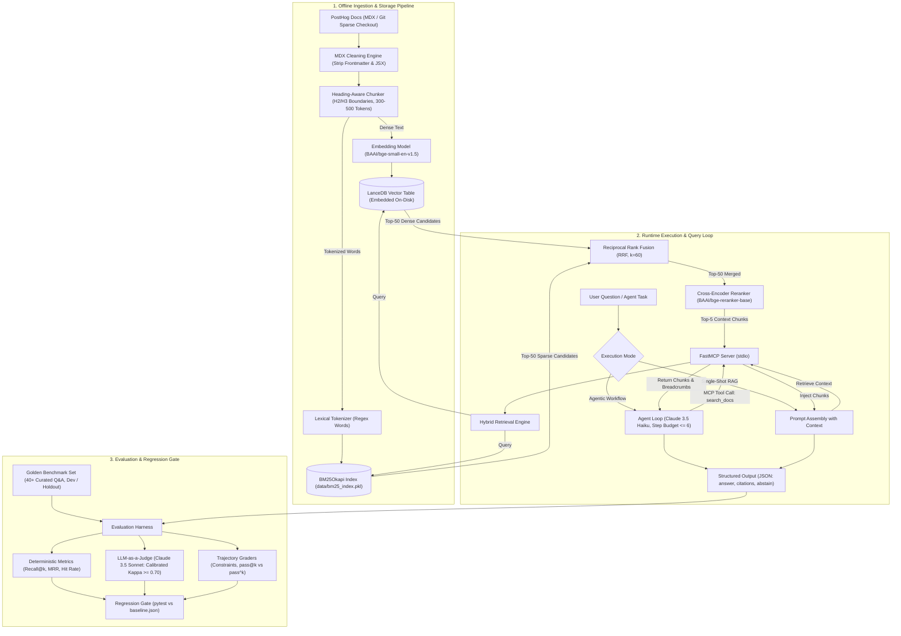

# System Architecture and Technology Stack

This document visualizes and details the end-to-end architecture of the `rag-agent-harness` system, spanning ingestion, dual storage, hybrid retrieval, agent tool-use execution, and the evaluation harness.

## Architecture Blueprint

## Layer Descriptions

### 1. Ingestion & Preprocessing
- **Source Corpus:** Public MIT-licensed documentation from `posthog.com/contents/docs`.
- **Cleaning Strategy:** Regular expression parsing strips YAML frontmatter and React/JSX tags while preserving inner container text, markdown headings, and fenced code blocks.
- **Heading-Aware Chunking:** Boundaries are defined by Markdown headings (`##` and `###`). Each chunk carries a breadcrumb metadata trail (`heading_path`) providing hierarchical context. Oversized sections (>500 tokens) are split on paragraph boundaries with 50-token overlap without severing code blocks.

### 2. Dual Index Storage
- **Dense Vector Store (LanceDB):** Embedded, serverless vector store with zero background daemon overhead. Stores 384-dimensional normalized float32 vectors generated by `BAAI/bge-small-en-v1.5`.
- **Sparse Lexical Index (BM25Okapi):** Serialized in-memory index over alphanumeric word tokens (`rank_bm25`) for exact keyword and identifier matching (e.g. CLI flags, API endpoints).

### 3. Hybrid Retrieval & Reranking
- **Reciprocal Rank Fusion (RRF):** Fuses dense and sparse candidate rankings without score scale dependency ($k=60$).
- **Cross-Encoder Reranking (`bge-reranker-base`):** Scores top-50 fused candidates with joint query-passage attention, delivering refined top-5 context chunks.

### 4. Consumption & Execution Layer
- **Direct RAG Mode:** Isolated prompt with strict citation constraints and structured Pydantic validation (`GenerationOutput`).
- **FastMCP Server & Agent Loop:** Model Context Protocol (v2) exposing `search_docs` over stdio. Autonomous tool-use loop on Claude 3.5 Haiku with a hard step budget ($\le 6$) and replayable JSONL trace logging.

### 5. Evaluation & Regression Gate
- **Golden Benchmark Set:** 40+ curated samples split into development and frozen holdout sets.
- **Metrics Suite:** Deterministic retrieval metrics (Recall@k, MRR), LLM-as-a-Judge calibrated with Cohen's Kappa, and multi-trial repeatability metrics (pass@k vs pass^k).
- **Regression Gate:** Automated `pytest` suite preventing quality regressions against `reports/baseline.json`.
